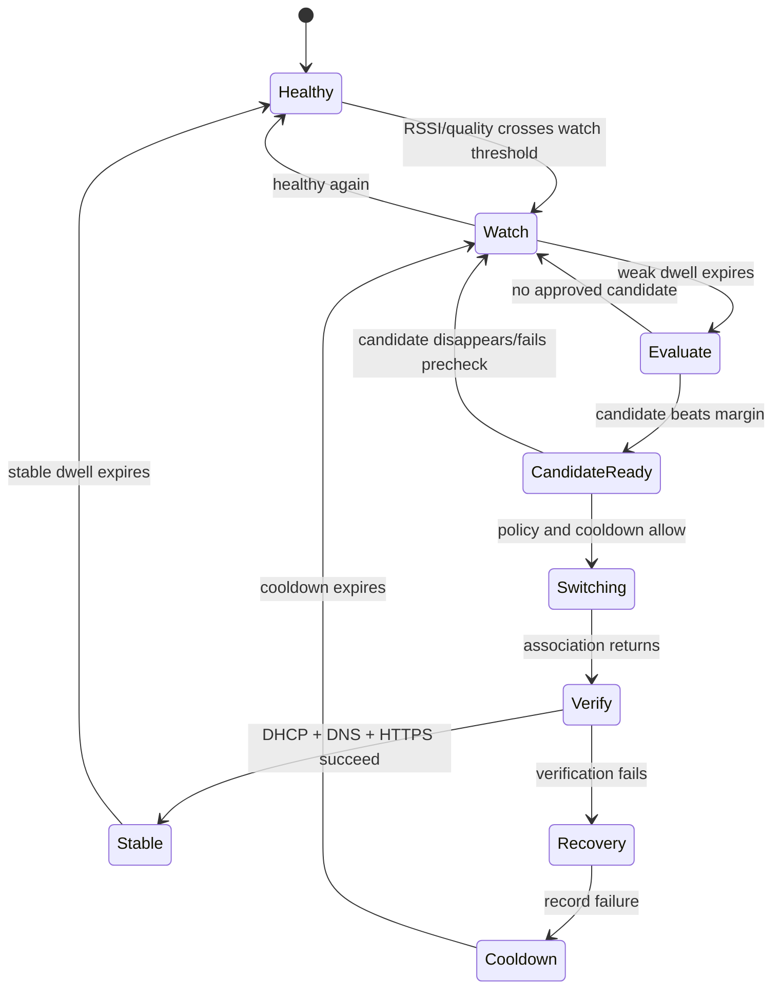

# Wi-Fi Glide decision engine

## Design goal

Avoid two bad outcomes:

1. **Battery waste:** repeatedly scanning for networks while the current connection is healthy.
2. **Roam storms:** switching back and forth because two networks are close in quality.

This policy is intended first for a MacBook client using public macOS/CoreWLAN capabilities. It is
also a platform-independent policy specification for any future platform that is allowed to make
the connection decision. It does **not** bypass iOS restrictions: an iPhone App Store app cannot
use this policy to force arbitrary background SSID changes.

## Do not use percentage signal strength

Wi-Fi "signal percentage" is a vendor-specific display value. Use the radio measurements exposed
by the platform instead:

- RSSI in dBm, where a value closer to zero is stronger (for example, -55 dBm is stronger than
  -75 dBm);
- noise and an estimated SNR when available;
- transmit rate as a supporting signal;
- association stability, packet loss, latency, DNS, and HTTPS reachability.

RSSI alone is not Internet quality. A strong signal can still have congestion, a broken gateway,
or a captive portal. Conversely, a lower RSSI can be perfectly usable.

## Core decision rule

Use both an **absolute floor** and a **relative margin**:

```text
Switch only when all are true:

  current_rssi <= CURRENT_WEAK_THRESHOLD
  candidate_rssi >= CANDIDATE_MINIMUM
  candidate_rssi - current_rssi >= HYSTERESIS_MARGIN
  weak/current-quality condition has lasted for MIN_WEAK_DWELL
  candidate is approved, recently observed, and not in failure cooldown
  candidate passes a post-association connectivity check
```

Example starting values for a MacBook proof of concept (not universal truths):

```text
CURRENT_WEAK_THRESHOLD = -67 dBm
CANDIDATE_MINIMUM      = -60 dBm
HYSTERESIS_MARGIN      = 10 dB
MIN_WEAK_DWELL         = 10 seconds
SCAN_COOLDOWN          = 30 seconds
SWITCH_COOLDOWN        = 90 seconds
```

The absolute thresholds should be configurable and measured against the target MacBook, access
points, bands, and application workload. The margin is more important than a percentage: a
candidate at -66 dBm is not meaningfully better than a current network at -67 dBm.

## Why a single 60% threshold is unsafe

Suppose a UI maps signal to a percentage:

```text
current = 59%
candidate = 61%
```

That does not prove the candidate is materially better. The mapping may be nonlinear, the two
measurements may be from different bands, and the candidate may have a slow or unreachable
gateway. Switching on that tiny difference can create oscillation and a needless interruption.

A safer interpretation is:

```text
current has become meaningfully weak
AND
the candidate is meaningfully stronger
AND
the candidate can actually reach the Internet
AND
we have stayed in this condition long enough
```

## State machine



## Battery-conscious monitoring

### Healthy connection

- Do not run an active scan on every timer tick.
- Subscribe to platform link-quality events where available.
- Read current-link metrics cheaply and infrequently, such as every 5–15 seconds.
- Use the operating system's scan cache if it is fresh enough.
- Keep the app dormant when the user has disabled automation or the interface is asleep.

### Degrading connection

- Enter `Watch` when RSSI or quality crosses a higher watch threshold, such as -60 dBm.
- Do not switch immediately. Require a dwell period.
- If the platform emits a stronger degradation event, schedule one evaluation sooner.
- Limit active scans with a cooldown; one scan may be enough to discover a candidate.

### Weak connection

- Run an active scan only after the weak dwell expires and only for user-approved networks.
- Rank candidates without associating to each one. Do not "try every SSID" just to measure it:
  doing that is disruptive and expensive.
- Consider one candidate at a time, preferably the strongest recent result.
- Abort if the current connection recovers before the association request begins.

### After a switch

- Do not immediately rescan and switch back.
- Enforce `SWITCH_COOLDOWN` and a minimum stable dwell.
- Record the previous network and the reason for switching.
- If verification fails, return to the last known-good network only once, then enter cooldown.
- Back off failed candidates exponentially.

### Device power state

- Be less aggressive on battery than on external power.
- Pause active scanning in Low Power Mode unless the current connection is unusable and the user
  explicitly allows it.
- Never wake the system repeatedly just to chase small RSSI changes.

## Quality score

The selector should rank a small set of approved candidates, not every visible network:

```text
score(network) =
    0.40 * normalized_rssi
  + 0.15 * normalized_snr
  + 0.15 * recent_success_rate
  + 0.15 * reachability_score
  + 0.10 * user_preference
  + 0.05 * stability_score
```

The exact weights are an experiment, not a product promise. Do not let the score hide hard safety
rules: an unknown network, failed credential, captive portal, or failed connectivity probe should
be ineligible regardless of its RSSI.

For the first POC, start with a simpler rule rather than machine learning. A deterministic policy
is easier to test, explain, tune, and trust. A learned model can be considered only after collecting
real measurements from multiple devices and homes without storing credentials or private payloads.

## Different SSIDs and disruption

This policy minimizes unnecessary switches; it cannot make a different-SSID handoff seamless.
With separate gateways or ISPs, the IP address, default route, NAT mapping, VPN path, and local
network may change. Existing TCP, VPN, and local services can fail even if the new RSSI is much
stronger.

For the Mac POC, report these separately:

1. **Association success:** did the Mac join the requested SSID?
2. **Network readiness:** did DHCP/default route/DNS complete?
3. **Internet reachability:** did a small HTTPS probe succeed?
4. **Session continuity:** did the user's existing workload survive?

Only the first three are reasonable client acceptance criteria for an initial switcher. Session
continuity needs a shared LAN/gateway or an application/network overlay and should not be claimed
from RSSI-based switching alone.

## Where context signals fit

The phrase **"JEV"** is ambiguous. If it means **GPS/geofencing**, it can be an optional context
signal (for example, suppress automation outside the home), but it should not be the primary
switch trigger: GPS does not measure Wi-Fi quality and may cost more battery than a thresholded
link event.

If it means **AI/ML**, it is unnecessary for the first version. Use the deterministic state machine
above, collect anonymized measurements locally, and only evaluate a model after the baseline policy
has a measured failure mode. If "JEV" refers to a particular framework or device capability, name
it before it is added to the architecture.

## POC acceptance criteria

- No active scans while the current connection remains healthy for the configured observation
  window.
- No switch when the candidate is less than the configured hysteresis margin better.
- No more than one switch attempt during the switch cooldown.
- A candidate is not selected unless it is in the user's approved list and passes post-association
  DHCP, DNS, and HTTPS checks.
- A failed candidate enters cooldown and does not cause a rapid retry loop.
- Every decision records reason, RSSI/noise metrics, candidate, outcome, and elapsed time without
  recording Wi-Fi passwords.
- The POC labels different-SSID switching as disruptive best-effort behavior.
